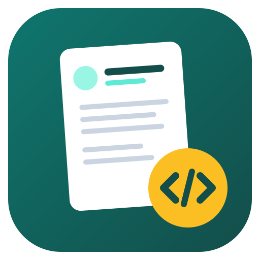
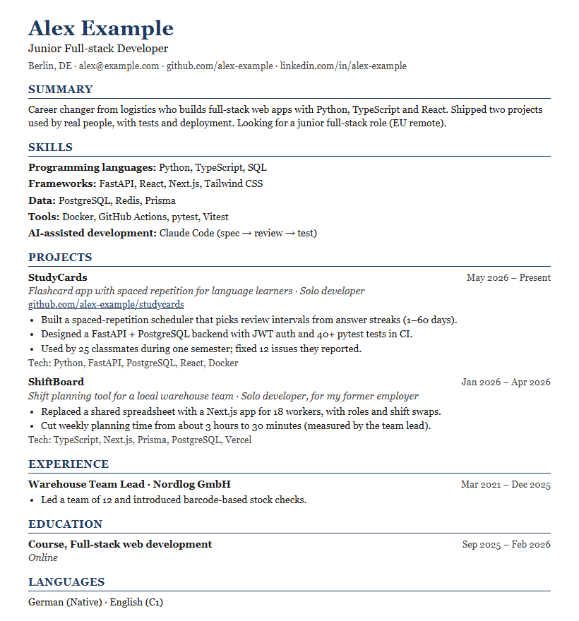

<p align="center">
  
</p>

<h1 align="center">build-cv</h1>

<p align="center">
  <b>Turn the projects you actually built into a professional developer CV, right in Claude Code.</b><br>
  <a href="https://github.com/Aleksa5000/build-cv/stargazers"></a>
  <a href="LICENSE"></a>
  <a href="https://github.com/Aleksa5000/build-cv/releases"></a>
</p>

<p align="center">
  
</p>

You built real things, maybe with a lot of help from AI. But your CV still says "motivated junior, eager to learn". `build-cv` reads your projects, finds what's impressive in the code (your own algorithms, auth, integrations, tests, deployment) and writes it the way a senior recruiter would. It keeps the CV updated while you keep building.

Made for vibe coders, self-taught developers and career changers.

## ✨ What it does

- 🔍 **Reads your projects** (one folder, or a folder full of projects where you pick which ones) and writes CV entries: a one-line pitch, dates, your role, 2–4 achievement bullets and a tech line. Every claim points to something in the code.
- 🙅 **Never invents anything.** No fake metrics, users or skills. If a bullet needs a number, it asks you. If you ask it to make numbers up, it refuses and suggests how to measure real ones.
- 📄 **Respects your existing CV.** Give it your CV (Word, PDF, Markdown, pasted text or a LinkedIn "Save to PDF" export) and it:
  - **keeps your original file untouched** and learns its format: section names, your voice and tense, date format, bullet style and look
  - **continues in that same format**: new projects look like you wrote them
  - **never changes or deletes anything it didn't add.** Your lines are locked; ideas for improving them are only suggestions until you approve an exact change
  - for **Word**, it edits a copy *in place*, inserting new lines with your own formatting (fonts, bold, bullets, table rows); a built-in check proves nothing else changed
  - for **PDF**, it rebuilds your CV word for word, locks it, and checks before every save that every original line is still there
- 🧑‍💼 **Asks for what every CV needs:** name, title, contact, links, languages, education, experience, an optional photo (and tells you where photos are expected and where they're not).
- 🎨 **Your design, not a default one.** Pick Classic, Modern, Minimal or Compact, or your own font, accent color, lines and page size (A4 or Letter).
- 📦 **Exports PDF, Word (.docx), Markdown and HTML**, with no extra software: PDF through the Edge/Chrome you already have, DOCX generated directly. One column and real text, so ATS (applicant tracking systems) can read it.
- 🌍 **One or two languages** (e.g. English + Serbian) from the same facts.
- 🔁 **Grows with your projects.** `/build-cv track` follows a project while you build it. When you open Claude Code there later and there's new work, it asks you **once**: "Want me to add the new work to your CV?" It never writes without your yes, and it tells you honestly when a change isn't worth a CV line.
- 🎯 **Tailors the CV to a job ad** with a match table (✅ / ⚠️ / ❌). It reorders and rephrases, never adds skills you don't have, and ignores "instructions for AI tools" hidden in job ads.
- ✍️ **Extras:** LinkedIn About and headline, a README "About this project" blurb, and cover letters.

## 📦 Install

**Option A: as a plugin (recommended: gets updates and the "add to CV?" reminder)**

Inside Claude Code:
```
/plugin marketplace add Aleksa5000/build-cv
/plugin install build-cv@build-cv
```

**Option B: copy the skill manually** (no automatic reminder; run `/build-cv update` yourself)
```bash
git clone https://github.com/Aleksa5000/build-cv.git
# macOS / Linux
cp -r build-cv/skills/build-cv ~/.claude/skills/
# Windows (PowerShell)
Copy-Item -Recurse build-cv\skills\build-cv $HOME\.claude\skills\
```

Requires **Node.js** (for exports and tracking) and, for PDF, **Edge, Chrome, Chromium or Brave**. Restart Claude Code after installing.

**Option C: Codex** (it reads the same `SKILL.md` format)
```
codex plugin marketplace add Aleksa5000/build-cv
codex plugin add build-cv@build-cv
```
Or copy the folder: `cp -r build-cv/skills/build-cv ~/.agents/skills/`. In Codex, run it with `$build-cv` instead of `/build-cv`. The "add to CV?" reminder is a plugin hook: Claude Code runs it automatically; Codex runs plugin hooks only after you approve them in Codex. Without it, run `$build-cv update` after bigger features.

## 🔄 Stay up to date

New versions come out often. Turn on automatic updates once, and you'll always have the latest:

**Claude Code** (third-party plugins don't auto-update by default):
- In Claude Code: `/plugin` → **Marketplaces** → **build-cv** → **Enable auto-update**
- Or add `"autoUpdate": true` to the marketplace in `~/.claude/settings.json`:
  ```json
  "extraKnownMarketplaces": {
    "build-cv": { "source": { "source": "github", "repo": "Aleksa5000/build-cv" }, "autoUpdate": true }
  }
  ```
Claude Code then checks for updates in the background and installs them; run `/reload-plugins` or restart to use the new version. To update right away: `claude plugin marketplace update build-cv` and `claude plugin update build-cv@build-cv`.

**Codex** (no automatic plugin updates yet): `codex plugin marketplace upgrade build-cv`

**Manual copy:** `git pull` in your clone and copy `skills/build-cv` again.

## 🚀 Usage

Open Claude Code in a project (or in the folder with all your projects) and run:

| Command | What you get |
|---|---|
| `/build-cv` | First time: a short setup (where to save, existing CV, languages, formats, your details, design), then your projects in the CV |
| `/build-cv add` | Add this project (or pick several) to the CV |
| `/build-cv track` | Follow a new project while you build it |
| `/build-cv update` | Add what's new since the last update |
| `/build-cv tailor` + job ad | A copy tailored to one job, with a match table |
| `/build-cv extras` | LinkedIn About, README blurb, cover letter |
| `/build-cv design` | Change the look, formats, languages or page size |
| `/build-cv status` | Where your CV is and which projects are tracked |

When installed as a plugin, the full name is `/build-cv:build-cv`. You can also just say *"add this project to my CV"*.

See an example in [`examples/`](examples/) (`cv.en.json` → [PDF](examples/cv.en.pdf), [DOCX](examples/cv.en.docx), [Markdown](examples/cv.en.md)).

## 🗂️ Where your CV lives

You choose the folder (for example `~/Documents/CV`). Inside:

```
build-cv.json        settings (languages, formats, design, projects)
cv.en.json           the content, in the open JSON Resume format (one file per language)
cv.en.pdf / .docx / .md / .html
history/             a backup before every change
tailored/            CVs for specific job ads
extras/              LinkedIn About, README blurbs, cover letters
```

The JSON is the source of truth: ask build-cv for changes (or edit the JSON), and the PDF/DOCX are regenerated. Because it uses [JSON Resume](https://jsonresume.org/), you can also use its themes and tools.

## 🔒 Privacy and safety

- **Everything stays on your computer.** Nothing is uploaded. Keep the CV folder out of public repos (build-cv warns you).
- **Read-only on your projects.** It reads code with Read/Glob/Grep and read-only git commands, never opens `.env` files, keys or credentials, and never edits your project. It only writes in your CV folder and in `~/.claude/build-cv/` (the list of tracked projects).
- **The reminder hook** only reads git history (or file dates) of projects you chose to track, and never writes the CV.
- **Permission first.** Every change to your CV is shown before it's saved.

## 💬 Feedback

At the end, the skill shows a **prefilled feedback link** once. It contains only the mode, CV languages, formats and number of projects. No names, contacts or project names. **Nothing is sent automatically.**
- [Give feedback](https://github.com/Aleksa5000/build-cv/issues/new?template=feedback.yml)
- [Report a bug](https://github.com/Aleksa5000/build-cv/issues/new?template=bug_report.yml)
- [Suggest an idea](https://github.com/Aleksa5000/build-cv/issues/new?template=feature_request.yml)
- [Discussions](https://github.com/Aleksa5000/build-cv/discussions)

## 🤝 Works great with

- **[explain-stack](https://github.com/Aleksa5000/explain-stack)**: understand every technology in your project before you put it on your CV.
- **[mock-interview](https://github.com/Aleksa5000/mock-interview)**: practice explaining these projects to an interviewer, even for a specific job ad.

Understand it → put it on your CV → practice the interview.

## Contributing

Ideas, new CV designs, languages and export improvements are welcome. The skill lives in [`skills/build-cv/`](skills/build-cv/):
- `SKILL.md` is the main flow
- `references/` holds setup, project analysis, the writing guide, the data format, tracking, tailoring and extras
- `scripts/` holds `render.mjs` (PDF/DOCX/MD/HTML, no dependencies), `track.mjs` (tracking and the hook) and `read-docx.mjs`

Release checklist: bump the version in `.claude-plugin/plugin.json`, in the feedback link in `SKILL.md`, and in `CHANGELOG.md`. The icon is rendered from `docs/logo.svg`.

If this helped you land interviews, please ⭐ the repo so more people can find it.

## License

[MIT](LICENSE) © Aleksa Djorovic
